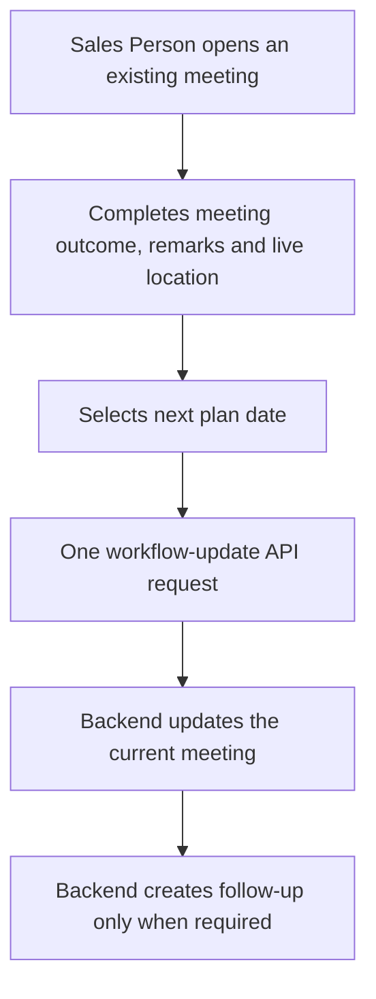

# BlueAnt CRM ERP Frontend

A role-based Expo / React Native CRM frontend for BlueAnt's lead, meeting, sales, and Sales Coordinator workflows. The application runs on Android, iOS, and web.

> **Scope of this README:** This is the handover document for the Sales Person and Sales Coordinator functionality implemented in this repository. It explains what the system does, how each role uses it, and which backend responsibilities are required for it to work correctly.

## At a glance

| Role | Main responsibility | Primary experience |
| --- | --- | --- |
| Sales Person | Work assigned leads, conduct meetings, and submit meeting outcomes. | Existing meeting update form and assigned-task workspace. |
| Sales Coordinator (SC) | Review meetings, collect verification details, assign leads, supervise task load, and export operational data. | Sales Coordinator workspace. |

## Technology

- Expo SDK 54
- React 19 and React Native 0.81
- TypeScript
- React Native Paper
- Web, Android, and iOS targets

## Latest updates - 6 November 2026

- PC Verified Meetings has a web Excel-compatible CSV export with nine columns: Name, PAN Number, Sales Person / RM / SC Name, Meeting Date, Next Plan Date, Remarks RM / SC, Remarks PC, Address and Location. It exports all records matching the current search and column filters, across mobile pages, using already-loaded data without additional API requests.
- The export button opens a masked password popup for every download. Incorrect passwords show an inline error; cancellation and successful downloads clear the input. This is a frontend-only confirmation gate, not backend authorization or file encryption.
- PC client-meeting mapping retains PAN from the existing client profile and keeps original meeting notes separate from PC verification remarks. Missing backend values remain blank rather than substituting a phone number or another person's remarks.
- These changes are scoped to the PC verified export. Pending RM/SC performance work and its unmeasured TEST benchmark results are not part of this release.
- Validation: isolated PC-only release passed all 105 regression tests, TypeScript checking and production web export. No live backend performance benchmark was run.

## Previous updates - 4 November 2026

- Reverted b5d821a at user request: restored pre-throttle client history requests and pre-PAN card/search behavior. Client Details improvements from 0d0507a remain. Per-client initial history fetching is unchanged; bulk backend summaries are still needed to eliminate that fan-out.

- RM/SC Client Details uses compact spacing and desktop field grids to reduce vertical scrolling. Latest Remarks and Your Prior Remarks are separate panels; prior remarks display client profile remarks with an empty-state fallback. Email has more desktop space and wraps fully; limited detail values expand on tap without repeated View full labels.
- Mobile Safari text inputs and textareas use a 16px font on narrow screens to prevent automatic focus zoom; other platforms retain their existing styles.

- RM/SC retains the originating task/client list while Details is open. Returning shows previous complete task results during fresh background reads; incomplete refresh responses do not replace the full calculation dataset. RM/SC task cards use virtualized rows, while search, filters, counts and ordering still use the complete dataset. SM and PC keep their existing screen flows.
- Client histories are fetched once per exact client code per initial task-loading cycle. An account-scoped, memory-only history store supplies immediate cached Client Details with fresh revalidation, 30-second active-screen polling and foreground/browser-reconnect refresh. Refresh errors retain old history with an error; leaving Details removes polling/subscriptions. Native offline detection remains limited to available lifecycle/connectivity signals.
- Client Details verification state follows the existing client-specific pending rule. Opening a client meeting update also checks fresh history and the active account. Submission invalidates older reads; logout/account changes clear history state and prevent old responses from publishing into another account.
- Lead/meeting service reads share only identical explicit in-flight refresh cycles. New navigation/manual/post-submission reads remain fresh, and older responses cannot overwrite newer results. No completed-response cache was added to these services.
- Initial loading still retrieves every required unique-client history and the bulk prospect meeting collections; virtualization and Details reuse do not eliminate backend response time or those initial requests. No backend API changes or pagination were introduced.
- Validation: 91 regression tests, including fixed pre-optimization output fixtures, plus TypeScript checking. Automated coverage includes task/count/order equivalence, later-record search, navigation retention, refresh failures/retries, polling cleanup, account isolation and submission races. Live end-to-end loading-time improvement has not been measured.

## Previous updates - 3 November 2026

- PC verified client meetings preserve verifiedBy and verifiedAt from the verification-list response when loading meeting details. Verifier/date appear in verified Details and are retained after a successful PC submission. Historical verifier identity still depends on backend data; failed sync can leave older records visible.
- CRM Assigned Leads now has an Excel-compatible CSV export with the PC's existing 27-column schema, lead deduplication, CSV escaping and active CRM filters. By request it exports only already-loaded CRM lead data, makes no extra meeting API calls, and leaves unavailable meeting/verification values blank (or the existing placeholder). Export errors/progress are visible on web.
- Two isolated calculation-only optimizations improve actionable-lead lookup and location-history selection. They retain first-match ID/code precedence, stable ties, record references and field output. API calls, caching, navigation, loading and other history calculations are unchanged. Added original-versus-optimized equivalence tests; synthetic timings are not end-to-end loading measurements.

- PC role resolution identifies Divya and Monika as SC across prospect/client rows, role filters and details labels, including missing or outdated role data. Monika currently uses a name fallback pending an authoritative employee code. Added regression coverage.
- Client Meeting Update validates required remarks, live coordinates and next-plan date, plus conducted-only mode, accompaniment, business selection, residential address and location. Address is limited to 500 characters. Required markers reflect editable fields; Not Conducted retains its fixed Tomorrow date.
- Prospect Meeting Update now requires live location for SC too. Existing conditional validation remains; hidden visiting-card capture stays disabled. Required applicable values must exist whether auto-filled or entered manually.
- Experimental SM/RM/SC workspace caching and client-loading changes were reverted; this update does not include that experiment.

- Client Meeting Update fixes Not Conducted follow-up to Tomorrow in both the read-only control and submitted payload. Conducted follow-up choices remain available.
- Conducted client meetings show Remarks, Address, Location, then Next Plan Date. The location dropdown includes the requested 11 areas. Optional Location maps to currentCity and Address maps to residentialAddress (500-character limit); neither is submitted for Not Conducted meetings.
- Client meeting outcome choices now display Investment, Service, and Only Discussion, mapping to backend businessGenerated YES, YES, and NO. PC verification retains its existing Yes/No controls; the backend boolean-style value does not distinguish Investment from Service.
- PC client verification and verified details display currentCity and residentialAddress when returned by the backend.
- PC role labels and filters recognize Amit Kumar Singh (AKS0108) as RM, including historical prospect records marked SM. This is a scoped display override; backend roles and RM/SM access rules are unchanged. Added regression coverage.

## Previous updates - 2 November 2026

- PC loading now reveals ready data immediately instead of waiting for all cosmetic percentage steps or a completion hold. Orbit loader reduced to 72px. Initial and deferred loading flags clear when requests finish, including immediate navigation to Assigned Leads after refresh.
- PC lead-history display numbering advances only after conducted meetings; unsuccessful attempts retain the current number. Backend titles are unchanged, and incomplete histories retain backend labels. Added numbering regression tests.
- Added TS1208 (Tejprakash Sharma) to the PC Assign Lead employee list.
- CRM Assigned Clients uses a compact striped table with existing search, filters and Details actions. CRM Assigned Leads opens the PC-style history view with lead, assignment, verification and meeting details.
- CRM assignments use the frontend-maintained employee list; automatic roles/users-search directory requests are disabled for this screen.
- Only the CRM Assigned Clients list uses the backend-provided Railway host: https://blueant-crm-erp.up.railway.app/api/v1/clients. Other requests keep their existing host. The Railway list still returns 403 ACCESS_DENIED for the observed CRM session; CRM meeting history also requires backend read permission. These authorization issues remain unresolved.

## Previous updates - 30 October 2026

- Prospect Meeting Update forms across roles now offer only Work In Progress and Converted as Client. Removed Client Not Interested, Remove This Client, and Already Blueant Client from the dropdown; historical status mappings remain compatible.
- Restored client task loading for RM and SC through an explicit role flag; SM continues to skip client APIs. Added role-specific mount/refresh regression checks.
- CRM Assigned Clients now reads paginated backend client records instead of relying on browser-local assignment history, and preserves loaded records after a new assignment. Backend deployment prerequisite: the CRM session currently receives 403 from GET /api/v1/clients; the correct authorized endpoint or scoped permission must be confirmed. GET /api/v1/roles also returned 500 during verification. These server issues are not resolved by this frontend change.
- Centered the PC orbit loader percentage and removed its small underline.

- Added an indigo/teal orbit loader with a central percentage and ten progress markers. Every 10% step is displayed at the current 700ms interval; it waits at 90% until data is ready, shows 100%, then reveals content after 220ms. These are visual preparation steps, not download percentages.
- Today and Verified meeting requests run in parallel and publish together, with verified history committed first for Today autofill. Assign Lead opens without the workspace loader.
- Added staged API/page loading callbacks, per-tab loading/error handling, and history completion callbacks. Removed the Loading coordinator workspace message.
- Simplified Lead History by hiding prospect/contact/company/source/assignment metadata, coordinator name/ID, and duplicate latest remarks. Best time remains in PC verification details; original prospect remarks and meeting history remain available.
- Added loader regression tests for visible steps, slow responses and timer cleanup, plus additional loading-stage tests.

## Previous updates - 29 October 2026

### PC mobile workspace improvements

- PC mobile navigation now lives in the hamburger menu: Today Meetings, Verified Meetings, Sales Person Tasks, Assign New Lead, and Assigned Leads. Dashboard is omitted; My Profile and Logout remain available. Desktop navigation and other role menus retain their existing behavior.
- Compact counters, manual sync icon, countdown, list headings, and pagination leave more space for records. Mobile lists use 25 records per page.
- Today and Verified meetings use compact colored rows with salesperson/role, conducted status, and Verify/Details actions. Verified rows retain meeting and next-plan dates.
- Mobile sales tasks hide masked phone numbers and place the All/Today/Pending dropdown beside search.
- Assigned-lead filters expand below search into one Date/Coordinator/Salesperson row. Compact lead summaries open full history through Details.
- The mobile assignment form keeps one column with shorter controls, consistent dropdown styling, and highlighted focus borders.
- Mobile verification has a fixed top-right close button and a fixed submit footer. Two-column fields and collapsible client/history sections reduce scrolling.
- Added MobileWorkspaceHeader.tsx, MobileMeetingCards.tsx, and MobileDetailSection.tsx for these mobile layouts.
- Today verification popups omit the read-only backend Meeting Date because the salesperson workflow does not submit an authoritative conducted date. The PC-selected verification date and Verified Meetings date displays remain available.


- Split Sales Manager tasks into focused styles, constants, date helpers, mappers, filters, dropdown, types, and state-hook modules under `src/modules/salesManager/tasks/`.
- SM task mount/refresh now loads prospects and meetings only. Removed client work-follow requests and the Clients filter because client tasks are not enabled for SM.
- Fixed nested HTML buttons in web task cards while preserving separate details/update actions and native card behavior.
- Split the coordinator workspace into forms, table, calendars, details/history, loading, filters, export, storage, types, constants, and controls under `src/screens/salesCoordinator/`. Main screen state, refresh, assignment, and verification orchestration remain in place.
- Coordinator desktop verification forms show four fields per row. Meeting Time displays only the hour and still submits `HH:00:00`. The date placeholder is **Select date**.
- Verified meeting rows use a compact **Details** action and extra Conducted / Verified By spacing.
- Added 20 regression tests for task logic/loading/actions and coordinator filters/forms/storage/pagination/CSV helpers.
- Added the [codebase file guide](Blueant-ERP-Codebase-File-Guide.pdf), with short Hinglish file explanations. It is a file guide, not a role-by-role permission reference.

### Refactor validation

```bash
npx tsc --noEmit
node --test src/modules/salesManager/tasks/__tests__/taskLogic.test.cjs src/modules/salesManager/tasks/__tests__/taskCard.test.cjs src/modules/salesManager/tasks/__tests__/smTaskLoading.test.cjs src/screens/salesCoordinator/__tests__/coordinatorLogic.test.cjs
npm run export:web
```

If Metro cannot resolve newly extracted files, restart with `npx expo start --web --clear`.

### Documentation maintenance

Update this README with relevant behavior, structure, and validation changes before each requested GitHub push.

## Previous updates — 21 September 2026

- Sales Coordinator screens no longer display Excel export buttons.
- The Assign New Lead employee dropdown shows `EMPLOYEE_CODE - Sales Person Name` when live employee data is available; its submitted value remains only the employee code.
- Duplicate mobile-number feedback attempts to identify the already assigned Sales Person and shows that name when the existing lead data provides it.
- The Sales Person task filter now displays **Today's Task**.
- All Sales Person task actions now use the label **Update Meeting**.
- Sales Person lead details now includes the lead's meeting history: meeting type, status, date/time, and next plan date.

## Run the project

```bash
npm install
npm run start
```

Other available commands:

```bash
npm run android
npm run ios
npm run web
npm run export:web
npx tsc --noEmit
```

## Sales Person workflow

A Sales Person receives and works leads/meetings. The critical action is **Meeting Update**.



### Meeting Update form

The form records meeting mode, result/status, remarks, live location, and a future next-plan date.

- **Meeting Date** is read-only and is loaded from the existing backend meeting date when the update form opens.
- **Next Plan Date** is a separate future follow-up date.
- Live location can include address, latitude, longitude, accuracy, and a maps link.
- The client prevents duplicate submits: the button is disabled during submission and the service prevents another request for the same meeting code while the first request is active.

### Correct update API contract

For an existing meeting, the frontend calls:

```text
POST /api/v1/meetings/{CURRENT_MEETING_CODE}/workflow-update
```

The frontend does **not** create a new meeting from this flow and never generates a meeting code. Follow-up creation and unique meeting-code generation are backend responsibilities.

## Sales Coordinator workspace

The SC workspace has five tabs.

| Tab | What SC can do |
| --- | --- |
| Today Meetings | Review meetings waiting for SC verification. |
| Verified Meetings | Search, filter, export, and inspect verified meetings. |
| Sales Person Tasks | See active Sales Person leads and meetings in one task list. |
| Assign New Lead | Create a physical lead and assign it to a Sales Person. |
| Assigned Leads | Filter SC-assigned leads, view complete history, and export organised records. |

The SC workspace loads pending-verification meetings, verified meetings, all meeting records, and SC-assigned leads. It has a manual sync action and automatic refresh every 10 seconds.

### Today Meetings and verification

Today Meetings lists work awaiting SC verification. SC can open a meeting and fill details including:

- Meeting time
- Age group
- Prior investment
- Profession and firm/clinic details
- Best time for a later meeting
- Meeting-with context
- Person name and position, only when the meeting was with someone else

The table keeps its column heading visible while the list scrolls.

### Verified Meetings

Verified Meetings provides:

- Sticky, aligned column headers
- Visible right-side list scrollbar
- Header search
- Multi-select column filters
- Meeting-date range filter
- Verified-by, lead status, meeting type, and Sales Person filters
- One-click CSV export through the green Excel icon

The exported CSV can be opened directly in Excel and includes meeting fields plus SC verification fields.

### Sales Person Tasks

This is the SC's workload view. It combines:

1. Active meetings that are not completed.
2. Assigned leads that do not already have an active meeting.

This prevents a lead from appearing twice when it already has a current meeting.

Task rows are divided into:

- **Today:** task date is today
- **Pending:** active but neither today nor overdue
- **Overdue:** task date is more than seven days old

The table contains Client Name, masked Number, Meeting Type, Sales Person, and Meeting Date. The Sales Person column has a multi-select filter. Historical short/full name values, such as `Garv` and `Garv Kumar`, are shown as one full-name option and filter both variants.

Search, All/Today/Pending/Overdue buttons, a sticky list header, scrollable rows, Clear action, and CSV export are included.

### Assign New Lead

SC can create and assign a physical lead with:

- Client name and mobile number
- Location, clinic address, and speciality
- Sales Person employee code
- Assigned date

Assigned Date uses a calendar picker with month navigation and a close button.

### Assigned Leads

Assigned Leads is a card-based operational list. Every card shows client details, masked mobile number, current lead status, assigned Sales Person, assigned date, and last-meeting/verification information.

Available filters:

- Search by name or number
- Assigned-date range
- Sales Coordinator
- Sales Person, available after selecting a coordinator

A Clear action appears after a filter is active and resets all Assigned Leads filters. Selecting a card opens full assignment, lead, SC-verification, and meeting-history information.

The Excel export creates one CSV row for every lead-meeting pair. A lead with five meetings produces five rows, ensuring its full timeline can be analysed in Excel. The filename includes the selected Sales Person and date range where available, for example:

```text
assigned-leads-Rajat-Gupta-16Sep-to-20Sep.csv
```

## Privacy behaviour

In SC visual lists, mobile numbers are masked. For example:

```text
9876543211 → 98******11
```

Operational exports retain their required data fields.

## Data completeness and reliability

- Assigned-lead results are fetched page-by-page, not only from the first API page.
- SC refresh logic avoids overlapping/stale refresh results.
- Verification submission blocks automatic refresh while it is in progress.
- Meeting update requests are guarded against accidental double clicks.

## Backend contract and ownership

| Area | Frontend does | Backend must do |
| --- | --- | --- |
| Existing meeting update | Sends one workflow update for the existing code. | Updates the meeting and creates follow-up only when necessary. |
| Meeting codes | Never generates/increments a code. | Generates unique codes and handles concurrency/database sequence correctly. |
| Duplicate submissions | Blocks rapid duplicate UI submits. | Rejects genuine duplicate writes and returns meaningful errors. |
| Task list | Combines returned active leads and meetings for display. | Returns correct statuses, assignments, and dates. |
| SC verification | Collects verification form data. | Validates and persists verification data. |
| Excel/CSV exports | Formats API data into downloadable CSV. | Supplies lead, meeting, assignment, and history data. |

## Duplicate meeting-code incident

If the frontend sends a request to:

```text
POST /api/v1/meetings/{CURRENT_MEETING_CODE}/workflow-update
```

and receives a response such as `DUPLICATE_RESOURCE` for a newly generated code, the frontend has used the correct update route. The backend workflow process attempted to create a follow-up code that already exists.

The backend must fix its follow-up meeting-code sequence/generation or cloned database state. Removing the database uniqueness rule or allowing duplicate codes would hide the real problem.

## Project map

| File | Responsibility |
| --- | --- |
| `App.tsx` | App routing and role-based screen selection. |
| `src/screens/SalesCoordinatorScreen.tsx` | Entire SC workspace, filters, verification, lead assignment, exports, and history. |
| `src/modules/salesManager/forms/LeadWorkflowForm.jsx` | Sales Person new-lead and meeting-update form. |
| `src/modules/salesManager/tasks/SalesManagerTasksScreen.tsx` | Sales Person task experience. |
| `src/services/MeetingService.ts` | Meeting loading, scope, submission guard, workflow update, and task visibility state. |
| `src/services/LeadService.ts` | Lead creation and Sales Coordinator lead assignment. |
| `src/api/meeting.ts` | Meeting API transport. |
| `src/api/lead.ts` | Lead API transport. |

## Sales dashboard activity

- **Assigned Leads List** shows every lead assigned to the logged-in Sales Person, regardless of lead status or assignment date.
- **Meeting Conducted List** shows only meetings recorded as `CONDUCTED` or `COMPLETED`, filtered by **Today**, **This Week**, or the previous calendar month (**Last Month**).
- **Client Created List** shows assigned leads whose status is `CONVERTED` or `ALREADY_CLIENT`, filtered by **Today**, **This Week**, or **This Month**.
- Client Created and Meeting Conducted dashboard cards show the same live date-range counts as their respective lists.
- Dashboard lists reuse the already scoped lead and meeting cache; they do not request a detail endpoint for every record when opened.
- Dashboard lists render all matching records without pagination controls.
- The Sales Person dashboard counts lead tasks from their **Assigned Date** and meeting tasks from their **Next Plan Date**; it uses the meeting date only when the backend has not returned a next-plan date. The existing Your Tasks schedule remains unchanged.
- **Today's Task** and **Pending Task** cards open their dedicated task views.
- Sales Coordinator lead assignment sends the backend `bestTimeForMeeting` enum: `NINE_TO_TWELVE`, `TWELVE_TO_THREE`, `THREE_TO_SIX`, or `SIX_TO_NINE`.

## Validation

Before release or handover, run:

```bash
npx tsc --noEmit
git diff --check
```

## Documentation maintenance

When functionality for Sales Person or Sales Coordinator changes, update this README in the same commit. This keeps the implementation and handover documentation aligned.

## Release update — 23 September 2026

- Sales Person laptop headers now use the same bell-and-hamburger menu as mobile. The menu contains the existing Sales Person destinations; the old desktop profile icon and task tabs are hidden for this workspace.

- Sales Person task cards now show the SC assignment date in **Last Updated** for Lead cards, and the meeting date for Meeting cards.

- Sales Person hamburger navigation now includes **Log out**, using the existing session-reset and sign-in flow.

- Sales Person task cards now keep the next workflow update locked while any earlier meeting for the same lead is awaiting SC verification. The card shows **Verification Pending** and disables **Update Meeting** until the pending verification is cleared by the existing backend verification flow.

- For an active Meeting card, **Last Updated** now shows the latest earlier/past meeting date for that lead. A future date for the currently scheduled meeting remains under **Next Follow-up**. If no earlier meeting exists, the SC assignment date is displayed.

## Release update - 30 September 2026

### Sales Person meeting outcomes

The Meeting Update form now starts with **Meeting Status** and supports two outcomes:

- **Meeting Conducted** keeps the normal fields in this order: Meeting Mode, read-only Meeting Date, Prospect Status, Joined With, Location Pinned, Remarks, and Next Follow Up.
- **Visited but Not Met** shows only Location Pinned, Remarks, and Next Follow Up.

A visited-but-not-met submission reuses the existing workflow endpoint and sends `meetingConducted: NOT_CONDUCTED`, `meetingRemarks`, the resolved `nextPlanDate`, latitude, longitude, and accuracy. It does not send Meeting Mode, Prospect Status, Joined With, or placeholder values for fields that do not apply.

The existing seven relative follow-up options work for both outcomes: Tomorrow, Day after tomorrow, After 3 days, This week (4 days), After 7 days, Next week (8 days), and After 15 days. Each option calculates a real date dynamically and sends it as `YYYY-MM-DD`.

### PC verification

- Conducted meetings retain the existing full verification questionnaire.
- `NOT_CONDUCTED` visits are identified from `meetingConducted` or `meetingStatus` and show only Meeting Time and Meeting Date for verification.
- Joined With is editable during conducted-meeting verification. The Sales Person's value is selected by default; choosing **With someone** displays Person Name and Position.
- Existing meeting and verification endpoints remain unchanged, and meeting codes continue to identify verification requests.

### Prospect details

The Sales Person prospect-details header is outside the scrolling content. The prospect name, meeting stage, Call, WhatsApp, and Update Meeting actions remain visible while prospect information and meeting history scroll beneath it.

### Validation

- `npx tsc --noEmit`
- `git diff --check`
- No production API submissions were made while validating these changes.
